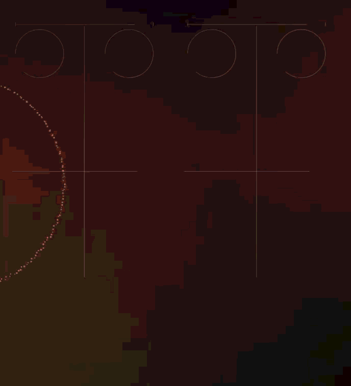
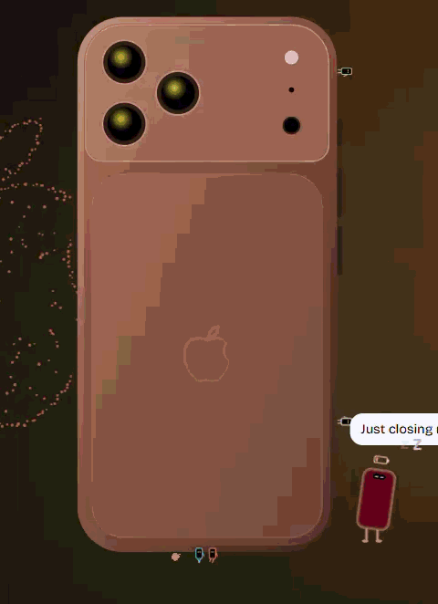

<div align="center">

# Concept 18 Pro

**A scroll-driven concept landing page for a phone, animated with no animation library.**





<sub>Portfolio project, not affiliated with Apple. Every spec on the page is invented.</sub>

</div>

## Tech stack

| Area             | Tools                                                                                                                  |
| ---------------- | ---------------------------------------------------------------------------------------------------------------------- |
| **UI**           | React 19 (`hydrateRoot`, `lazy` / `Suspense`, `useSyncExternalStore`), TypeScript 5.8 in strict mode                   |
| **Build**        | Vite 6: client build, SSR build and a prerender into static HTML                                                       |
| **Styles**       | SCSS modules with readable BEM class names, design tokens, rem container queries                                       |
| **Motion**       | CSS scroll-driven animations, compositor-only keyframes, Canvas 2D, SVG, one hand-written `requestAnimationFrame` loop |
| **Tests**        | Vitest + Testing Library + jsdom; Playwright on Chrome, Pixel 7, Firefox, iPad and iPhone (WebKit); axe-core           |
| **Code quality** | ESLint 9 (typescript-eslint strict, jsx-a11y, react-hooks), Stylelint, Prettier, knip, madge                           |
| **Performance**  | My own probe over the Chrome DevTools Protocol: frame times, long tasks, style recalcs, layers                         |

The only runtime dependencies are `react` and `react-dom`. There is no GSAP, Framer Motion, Lenis or Lottie.

## Problems solved

### Animation

- **One frame loop for the whole page.** `src/hooks/frameLoop.ts` owns the only `requestAnimationFrame`, the only scroll listener and the only pointer listener. Each frame runs a read phase and then a write phase, so the page never forces a layout by mixing the two. The loop stops as soon as nothing is moving.
- **Scroll is a timeline, not a JS variable.** Pinned sections, the exploded view, reveals and the progress line run on `animation-timeline: scroll()` / `view()`, so the compositor animates them. Firefox has no scroll timelines, so there the same keyframes are created paused and their `currentTime` follows the scroll. React never re-renders while you scroll.
- **Mean frame time over a full scroll went from 68 ms to 17.8 ms.** Two things did most of it: no custom property written every frame on `<html>` or a section (one inherited write was restyling 1 870 nodes), and looping animations kept to `transform` / `opacity`. Tests in `config/` fail on any `will-change` outside the allowed mixin and on any per-frame custom property that inherits.
- **An exploded phone made of flat SVG layers**, given depth with nothing but `translateZ`. It assembles into a finished phone with a lock screen, a glint and real band thickness, all driven by one progress value.
- **Particles that gather into shapes.** A Canvas 2D field forms a different shape next to each image. When two targets are close, the particles split between them instead of blurring into one smudge. The 400 points of the logo are computed at build time.
- **Letters that run away without touching the DOM.** The CSS Custom Highlight API paints a glyph transparent while a copy with legs runs off in an overlay. The text, the kerning and selection all stay intact.
- **A mascot with physics.** Pip walks the bottom of the window, dodges links and form fields, and can be dragged and thrown. It lands on one of seven rigs (parachute, balloons, glider…). Mini-Pips play football on the product render.
- **Off-screen things sleep.** `content-visibility: auto`, an `[data-awake]` gate on ambient loops, and lazy chunks that load after the page is interactive and are skipped entirely with reduced motion.

### Beyond animation

- **First paint without JavaScript.** The page is prerendered at build time. An inline script in `<head>` applies the saved finish and accessibility settings before the first paint, so a reload never flashes the defaults.
- **A real accessibility panel.** Motion: Full / Calm / Off. Text size from 100 to 200 % (the layout adapts through rem container queries). High contrast at 7 : 1. A light theme. WCAG reading spacing. Contrast for every combination is computed in a unit test and checked again with axe.
- **Readable CSS module names.** A custom `generateScopedName` turns hashes into BEM (`exploded-view__stack`), and a test enforces it.

## Run it

```sh
npm install
npm run dev        # http://localhost:5173
npm run build      # type-check, build, prerender
npm test           # Vitest
npm run test:e2e   # Playwright in 5 browser profiles
```

How every effect works, the performance rules, the budget table and the known gaps are in [`docs/README.md`](docs/README.md). The plans the page was built from are in [`docs/`](docs/).
