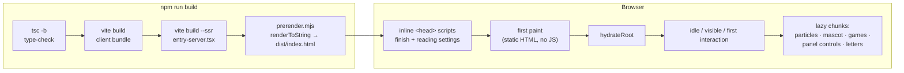

<div align="center">

# Concept 18 Pro — Under the Hood

**A scroll-driven concept landing page built with no animation library, one frame loop and a measured performance budget.**


<sub>Portfolio project. Not affiliated with Apple — every spec on the page is invented.</sub>

</div>

---

## Contents

- [At a glance](#at-a-glance)
- [The stack](#the-stack)
- [Architecture](#architecture)
- [The motion engine](#the-motion-engine)
- [Platform APIs used](#platform-apis-used)
- [Styling system](#styling-system)
- [Accessibility](#accessibility)
- [Quality gates](#quality-gates)
- [Performance budgets](#performance-budgets)
- [Build pipeline](#build-pipeline)
- [Project layout](#project-layout)
- [Run it](#run-it)

---

## At a glance

|                          |                                                                                                                   |
| ------------------------ | ----------------------------------------------------------------------------------------------------------------- |
| **Runtime dependencies** | `react`, `react-dom` — nothing else ships to the browser                                                          |
| **Animation libraries**  | none: CSS scroll timelines, compositor-only keyframes and a single hand-written `requestAnimationFrame` loop      |
| **Rendering**            | static prerender at build time + hydration, so the headline paints before any JS runs                             |
| **Code splitting**       | 10+ lazy chunks (particles, mascot, hero decoration, games, panel controls…) loaded after the page is interactive |
| **Source**               | ~220 TS/TSX modules, ~45 SCSS modules, components kept under 150 lines                                            |
| **Tests**                | 40+ Vitest suites, 10 Playwright specs across 5 browser profiles, plus a performance suite                        |
| **Lint**                 | ESLint (strict TS + a11y), Stylelint, Prettier — `--max-warnings 0`                                               |

---

## The stack

### Core

| Technology                                       | Version | Role                                                                                                                                                                                                                         |
| ------------------------------------------------ | ------- | ---------------------------------------------------------------------------------------------------------------------------------------------------------------------------------------------------------------------------- |
| [**React**](https://react.dev)                   | 19      | UI. `hydrateRoot` over prerendered HTML, `lazy` + `Suspense` for deferred scenes, `useSyncExternalStore` for every external store (settings, clocks, media queries, save-data) so server and client snapshots never disagree |
| [**TypeScript**](https://www.typescriptlang.org) | 5.8     | `strict` plus `noUncheckedIndexedAccess`, `exactOptionalPropertyTypes`, `verbatimModuleSyntax`, `isolatedModules`                                                                                                            |
| [**Vite**](https://vite.dev)                     | 6       | Dev server, client build (`es2022`, CSS code-split), SSR build for the prerender, custom plugin that injects `<head>` scripts                                                                                                |
| [**Sass**](https://sass-lang.com)                | 1.105   | SCSS modules, design tokens, motion mixins, container-query breakpoints                                                                                                                                                      |

### Tooling & quality

| Tool                                                                           | Role                                                                                                                                                                                             |
| ------------------------------------------------------------------------------ | ------------------------------------------------------------------------------------------------------------------------------------------------------------------------------------------------ |
| [**Vitest**](https://vitest.dev) + [**jsdom**](https://github.com/jsdom/jsdom) | Unit tests for hooks, pure animation math, game logic — and for the codebase itself (see [Quality gates](#quality-gates))                                                                        |
| [**Testing Library**](https://testing-library.com) (`react`, `dom`)            | Hook and component tests                                                                                                                                                                         |
| [**Playwright**](https://playwright.dev)                                       | E2E on Desktop Chrome, Pixel 7, Firefox, iPad Pro and iPhone 15 (WebKit); headed Chromium perf runs; share-image rendering                                                                       |
| [**@axe-core/playwright**](https://github.com/dequelabs/axe-core-npm)          | Automated accessibility audits inside the E2E suite, including AAA contrast in high-contrast mode                                                                                                |
| [**ESLint 9**](https://eslint.org) (flat config)                               | `typescript-eslint` strict, `react-hooks`, `react-refresh`, `jsx-a11y` strict, no `any`, no `console`                                                                                            |
| [**Stylelint**](https://stylelint.io)                                          | `stylelint-config-standard-scss` + project rules: no `!important`, max nesting 2, BEM class pattern, no vendor prefixes, **no raw `prefers-reduced-motion`** (must go through the motion mixins) |
| [**Prettier**](https://prettier.io)                                            | Formatting, checked by `npm run lint`                                                                                                                                                            |
| [**knip**](https://knip.dev)                                                   | Dead files, exports and dependencies                                                                                                                                                             |
| [**madge**](https://github.com/pahen/madge)                                    | Circular import detection                                                                                                                                                                        |
| **Chrome DevTools Protocol**                                                   | Custom perf probe (`scripts/perf-probe.mjs`): rAF intervals, long tasks, style recalcs, forced layouts with JS stacks, non-composited animations, layer count, overdraw                          |

---

## Architecture



**Key decisions**

- **Prerender, then hydrate.** The page is rendered to a string at build time and injected into `dist/index.html`. LCP does not wait for the bundle.
- **No flash of defaults.** A custom Vite plugin (`rememberedFinish` in `vite.config.ts`) prepends two inline scripts that read `localStorage` and set attributes on `<html>` before first paint — the chosen colour finish and every accessibility setting survive a reload without a flicker.
- **Everything decorative is a chunk.** The particle canvas, the walking mascot, the hero decoration, the football mini-game, the runaway letters and the accessibility controls are split out and mounted on idle, on visibility or on first intent (hover / focus / press). With reduced motion most of them are never fetched.
- **Content is data.** Copy lives in `src/content/`, specs in `specs.ts`; components only lay it out.

---

## The motion engine

There is **no GSAP, Framer Motion, Lenis or Lottie**. Motion is built from three layers, each picked for where it runs:

| Layer                                                                                              | Runs on     | Used for                                                                                    |
| -------------------------------------------------------------------------------------------------- | ----------- | ------------------------------------------------------------------------------------------- |
| **CSS scroll-driven animations** — `animation-timeline: scroll()` / `view()`, named view timelines | Compositor  | Pinned sections, the exploded phone view, reveals, the header progress line, the backdrop   |
| **CSS keyframes** on `transform` / `opacity` only                                                  | Compositor  | Ambient loops: waves, pulses, floating parts, the mascot's rigs                             |
| **One `requestAnimationFrame` loop** — `src/hooks/frameLoop.ts`                                    | Main thread | Physics and state: particles, the mascot, the mini-game, counters, pointer-reactive effects |

### `frameLoop.ts` — one loop to rule them all

The module owns **the only rAF loop, the only scroll listener and the only pointer listener** on the page. Every frame is split into phases:

```
┌──────────── frame ────────────┐
│ read  → every listener measures │   lastScrollY(), viewportSize(), pointer
│ write → queued DOM writes flush │   write(() => el.style.transform = …)
└─────────────────────────────────┘
```

- Listeners never touch `window.scrollY` or `innerWidth` (Blink restyles before answering those) — they read cached frame values.
- Timer-started work that needs to measure goes through `readInNextFrame()`.
- Tick listeners **unsubscribe the moment their subject stands still** — a settled particle field or a sleeping mascot schedules zero frames.
- Layout measures are marked with `performance.mark`, so the perf probe can count them.

### Graceful fallback

Where scroll timelines are missing (Firefox stable), the same keyframes are created **paused**, and `animationDriver.ts` sets their `currentTime` from the scroll position. No custom property restyles a section on every frame, and React never re-renders while scrolling.

### The nine performance rules

Every moving feature follows a written rulebook, and several rules are enforced by tests:

1. Per-frame values never inherit — never written on `<html>`, `<body>` or a section; custom properties are registered with `@property { inherits: false }`.
2. Scroll position is a timeline, not a variable.
3. Read, then write — through `write()`.
4. Loops live on the compositor: `transform` / `opacity` on HTML elements or root `<svg>`s only.
5. No filters on moving things — glows are gradients.
6. `will-change` only while awake (`promote-while-awake` mixin), dropped at rest.
7. Off-screen things sleep — `content-visibility: auto`, `[data-awake]` gating.
8. The loop sleeps.
9. Budgets are measured, and a budget only moves down.

---

## Platform APIs used

A tour of the web platform features this page leans on:

| API                                                                  | What it does here                                                                                                                           |
| -------------------------------------------------------------------- | ------------------------------------------------------------------------------------------------------------------------------------------- |
| **Scroll-driven animations** (`scroll()`, `view()`, `view-timeline`) | All scroll-linked motion, off the main thread                                                                                               |
| **CSS Custom Highlight API** (`CSS.highlights`, `::highlight`)       | "Runaway letters": a glyph is painted transparent while a copy with legs runs off in an overlay — the DOM and the kerning are never touched |
| **`@property`**                                                      | Typed, non-inheriting custom properties for per-frame values                                                                                |
| **Container queries** (`@container`, rem-based)                      | Breakpoints follow text size: at 200 % text a 1280 px window gets the 640 px layout                                                         |
| **`content-visibility` / `contain-intrinsic-size`**                  | Off-screen sections skip style, layout and paint                                                                                            |
| **IntersectionObserver**                                             | Waking / sleeping scenes, reveal fallback                                                                                                   |
| **ResizeObserver**                                                   | Sizes without forced layouts                                                                                                                |
| **Canvas 2D**                                                        | Particle field that gathers into a different shape beside each image (400-point apple mark precomputed at build time)                       |
| **SVG `pathLength` + `stroke-dashoffset`**                           | Blueprint line drawing, self-drawing outlines                                                                                               |
| **CSS `d` property**                                                 | Pause ↔ play icon morph (with a crossfade where WebKit lacks it)                                                                            |
| **`color-mix()`, CSS masks**                                         | Finish-aware gradients, marbled paint header                                                                                                |
| **Pointer Events + `setPointerCapture`**                             | Draggable, throwable mascot                                                                                                                 |
| **`inert`, `aria-live`**                                             | Closed panel is unreachable; every change is announced                                                                                      |
| **`requestIdleCallback`**, **Save-Data** (`navigator.connection`)    | Deferring work; honouring data-saver                                                                                                        |
| **`prefers-reduced-motion`, `prefers-contrast`, `forced-colors`**    | Motion, contrast and Windows High Contrast support                                                                                          |

---

## Styling system

- **SCSS modules with readable BEM class names.** `config/bemClassName.ts` replaces Vite's hashed names: the module file is the block, `.root` is the block itself, other classes become elements — the DOM reads `exploded-view__stack`, not `_stack_x7f3a`. A Vitest check fails on duplicate blocks or names outside the pattern. As a bonus, global keyframes are no longer renamed by CSS modules.
- **Design tokens** in `_tokens.scss`: colour finishes, fluid type steps (rem + `vw`), spacing, contrast-specific overrides, a light and a high-contrast light set.
- **Motion mixins** in `_mixins.scss` — `motion-safe`, `motion-reduce`, `motion-ambient`, `when-awake`, `hover-motion`, `driven`, `promote-while-awake`. One attribute on `<html>` (`data-motion`) plus the OS setting feed all of them; Stylelint bans writing a reduced-motion query by hand.
- **Variable font**: Bricolage Grotesque (OFL), self-hosted as a single `woff2` weight axis.

---

## Accessibility

A built-in reading panel, applied before first paint and announced through a live region:

| Setting       | Options                                             | Notes                                                                                                                                                |
| ------------- | --------------------------------------------------- | ---------------------------------------------------------------------------------------------------------------------------------------------------- |
| **Motion**    | Full · Calm · Off                                   | _Calm_ stops ambient motion, keeps scroll effects. _Off_ equals `prefers-reduced-motion`: pinned sections fall into normal flow at their final frame |
| **Text size** | 100 – 200 %                                         | Layout follows via rem container queries                                                                                                             |
| **Contrast**  | Standard · High                                     | ≥ 7 : 1 text, 3 : 1 lines, finish-independent focus ring; `forced-colors` has its own rules                                                          |
| **Theme**     | Dark · Light                                        | Every finish keeps 4.5 : 1 (7 : 1 in high contrast)                                                                                                  |
| **Reading**   | spacing, system font, underlined links, hide mascot | Spacing uses the WCAG 1.4.12 values                                                                                                                  |

Contrast ratios for every finish × theme × contrast combination are **computed in a unit test** (`config/contrast.test.ts`) and checked again by axe in the browser. No "accessibility overlay" claims, no TTS or colour filters — the OS does those better.

---

## Quality gates

The `config/` folder holds tests that check **the codebase itself**, not just the behaviour:

| Test                         | Fails when…                                                                                   |
| ---------------------------- | --------------------------------------------------------------------------------------------- |
| `bemClassName.test.ts`       | a class name breaks the BEM pattern or a block name is duplicated                             |
| `willChange.test.ts`         | `will-change` appears outside `promote-while-awake` or a waking attribute                     |
| `perFrameProperties.test.ts` | JS writes a custom property that is not registered as non-inheriting                          |
| `motionMixins.test.ts`       | a motion mixin stops respecting the panel's motion levels                                     |
| `contrast.test.ts`           | any finish / theme / contrast pair drops below its ratio                                      |
| `scrollRanges.test.ts`       | the exploded view's scroll windows drift, or the JS fallback stops mirroring the CSS timeline |
| `breakpoints.test.ts`        | the rem breakpoints in SCSS and TS stop matching                                              |

Then:

- **Vitest** — hooks, easing and progress math, the football game, letter wrapping, glyph metrics.
- **Playwright E2E** — smoke, runtime errors, lazy-loading, the accessibility panel, every feature pass; on Chromium, Firefox and WebKit, desktop and mobile.
- **Playwright perf** (`@perf`) — headed Chromium on desktop and Pixel 7, holding frame-time, long-task, recalc and layer budgets.

```sh
npm run lint && npm test && npm run build && npm run test:perf
```

---

## Performance budgets

Measured with the in-house CDP probe, headed Chromium, 1440 × 900:

| Scenario                             | Before the perf pass | Now              |
| ------------------------------------ | -------------------- | ---------------- |
| Full scroll, mean frame              | 68 ms                | **17.8 ms**      |
| Full scroll, long tasks              | 183                  | **0 – 1**        |
| Idle in every section, mean frame    | 16.7 – 17.4 ms       | **16.7 ms**      |
| Idle, style recalcs per frame        | 3.2                  | **1.0 – 1.2**    |
| Pointer sweep over the hero          | 17.4 / 22 ms         | **16.7 / 17 ms** |
| Colour finish change, longest task   | 238 ms               | **50 – 106 ms**  |
| Startup, long tasks in the first 2 s | —                    | **0**            |

Open gaps — bundle size over its target, layer count at the hero, real-device checks — are tracked honestly in the README's _Known gaps_.

---

## Build pipeline

```sh
tsc -b                                        # type-check all projects
vite build                                    # client bundle, CSS split per chunk
vite build --ssr src/entry-server.tsx         # server bundle for the prerender
node scripts/prerender.mjs                    # renderToString → dist/index.html
```

Helper scripts:

| Script                              | Purpose                                                             |
| ----------------------------------- | ------------------------------------------------------------------- |
| `scripts/generate-apple-points.mjs` | Samples the brand mark path into 400 particle targets               |
| `scripts/render-share-images.mjs`   | Playwright screenshots → `og-image.jpg`, favicons, apple-touch-icon |
| `scripts/perf-probe.mjs`            | CDP performance probe, optional JSON report                         |

---

## Project layout

```
src/
├── app/            App shell
├── components/     ~20 feature folders (Hero, ExplodedView, Backdrop, Mascot, Finishes, A11yPanel…)
├── hooks/          frameLoop, animationDriver, useViewProgress, useInView, a11y store, clocks…
├── assets/svg/     hand-built SVG components: phone outline, render, layers, living marks
├── content/        all copy and specs
├── styles/         tokens, mixins, breakpoints, global
└── entry-server.tsx
config/             BEM naming + tests that guard the codebase rules
e2e/                Playwright specs, perf probe helpers and allowlist
scripts/            prerender, perf probe, asset generators
docs/               numbered build plans (0–9) and the frontend rulebook
```

---

## Run it

```sh
npm install
npm run dev          # http://localhost:5173
npm run build        # type-check, client build, prerender
npm run preview      # http://localhost:4173
npm test             # Vitest
npm run test:e2e     # Playwright, 5 browser profiles, with axe
npm run test:perf    # headed Chromium performance budgets
npm run perf         # the probe (needs npm run preview)
npm run lint         # ESLint + Stylelint + Prettier
```

<div align="center">
<br/>
<sub>Built by hand, frame by frame. For the full story of what moves and why, see <a href="README.md">README.md</a> and the plans in <a href="docs/">docs/</a>.</sub>
</div>
