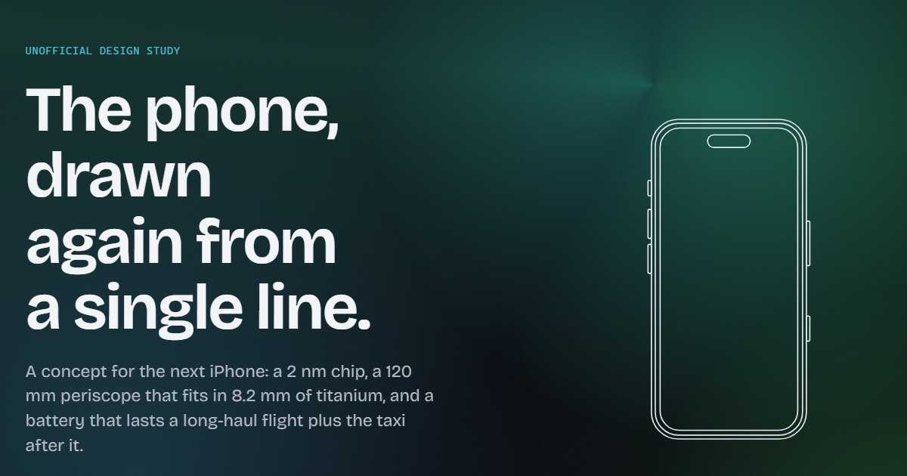

# Concept 18 Pro

A scroll-driven concept page for a next-generation phone. Every spec on the page is invented.



Live URL: not deployed yet. `npm run build` produces a static `dist/` that any static host can serve.

## Run it

```sh
npm install
npm run dev          # http://localhost:5173
npm run build        # type-check, client build, prerender into dist/index.html
npm run preview      # serve dist/ on http://localhost:4173
npm test             # Vitest: hooks and pure animation math
npm run test:e2e     # Playwright: Chrome, Pixel 7, Firefox, iPad and iPhone (WebKit), with axe
npm run test:perf    # headed Chromium, desktop and Pixel 7: the runtime budgets below
npm run perf         # the probe: frame times, recalcs, forced layouts, layers per scenario (needs npm run preview)
npm run lint         # ESLint, Stylelint, Prettier
```

`npm run points` regenerates the 400 apple-mark particle targets from `src/assets/svg/apple-mark-path.ts`. The other particle shapes are polylines in `src/components/Backdrop/particleShapes.ts`, sampled at runtime.

The plans the page was built from live in `docs/`: `0-plan-landing.md` for the page itself, `1-plan-motion-and-detail.md` for the second pass with the mascot `2-plan-play-and-polish.md` for the third pass with Pip combos, the nav indicator and more motion on load, `3-plan-accessibility-panel.md` for the accessibility panel, `4-plan-living-details.md` for the fourth pass with the runaway letters and the living marks, `5-plan-hover-and-play.md` for the fifth pass with the hover answers, the draggable Pip and the lazy scenes, `6-plan-animation-performance.md` for the performance pass whose rules are below, `7-plan-games-and-surfaces.md` for the seventh pass with Pip's joy and slingshot, the football on the finishes render and the living surfaces, then `8-plan-paint-and-fixes.md`, `9-plan-bitten-mark-and-mesh.md` and `10-plan-project-details.md` for the eighth, ninth and tenth passes.

## How the motion works

There is no animation library. One module, `src/hooks/frameLoop.ts`, owns the only `requestAnimationFrame` loop, the only scroll listener and the only pointer listener. Each frame has a read phase, where every listener measures, and a write phase, where the queued DOM writes run together. Anything that follows the scroll position is a CSS scroll timeline: the pinned sections are named view timelines whose keyframes run on the compositor, the backdrop and the header line follow `scroll(root)`. Where a browser has no scroll timelines (Firefox stable today), the same keyframes are paused and the hooks set their `currentTime` from the scroll position, so no custom property restyles a whole section on every frame and React never re-renders while you scroll.

Simple reveals (titles, ledes, the chip table rows) use `animation-timeline: view()` where the browser has it and an IntersectionObserver fallback where it does not; text is never hidden without JavaScript. Mono labels decode once on entry through an `aria-hidden` overlay, and the sentence under "The numbers" lights up word by word from its own crossing progress, backwards too. With reduced motion (the OS setting or "Motion: off" in the accessibility panel) every pinned section drops into normal flow at its final frame, the counters show their values and the particle canvas is never loaded.

Ambient motion is everything that moves without the reader doing anything: the pulse and the idle nudges on primary buttons (a buzz or a sheen every 7 s, at most five per visit to the view, never again once hovered), the bugs in the empty email field, the drifting waves on dark blocks and the backdrop, the floating hero phone and the parts drifting around it, the breathing particle shapes and Pip. It only runs while its element is on screen, and the "Pause motion" button in the header and footer stops all of it and remembers the choice (it is the "Calm" level of the panel's motion setting). Scroll-driven effects keep working when motion is paused, because they follow the reader. The pause button itself still animates on click (the bars fold into the play triangle through CSS `d`, with a crossfade where WebKit has no `d`), since that is the answer to the reader's own action.

The hero phone boots after the headline: its screen lights up with the time and three notifications and a cable plugs in. That decoration is a separate chunk loaded after hydration, so it never touches the LCP. In the exploded view the stack ends as a finished phone: the glass is clear, the black OLED panel wakes into the lock screen once the glass lands, a glint crosses it, the band gets real thickness from stacked slices and the camera turns to a three-quarter view, all from the same `--p`.

The header nav marks the section in view with a tiny landscape phone on legs that runs to the active link, as wide as its text. The finish you pick is stored and applied by an inline script in `<head>`, so a reload shows it from the first paint.

Particles drift with scroll and gather into a different shape beside each image: a spark by the hero, a compass by the line drawing, a gear by the exploded view, a lens, sun, chip and lattice by the feature cards, the apple by the finishes and a check mark by the form. Each particle picks one nearby shape by weight and eases toward it, so two cards side by side split the particles between them instead of blurring into one smudge.

Pip is a pocket phone with legs that walks along the bottom of the window. Its face is the cutout. Between walks it takes selfies, naps, dances, trips, checks itself in a mirror and makes dry remarks; fast scrolling blows it back, and poking it (it is a real button) makes it complain through a polite live region. Two, three and four quick pokes are combos (a screenshot, a dizzy spin, airplane mode), and now and then it hints at the ones you have not found. It also waves, takes calls, charges, moonwalks, stretches and juggles screws. It stops while it has focus or the pointer is on it, and its eyes follow the pointer then. It keeps itself off links and fields in the footer, the form and the sticky bar instead of fading out, and is not loaded at all under reduced motion or when motion is paused.

The fourth pass adds small living details. The attention ring on primary buttons now pulses without end while the button is on screen (a rest between pulses, half a cycle apart on the header and hero buttons, gone while hovered, focused or nudged). The scrollbars follow the site's palette and the finish. The spark, compass and gear shapes turn a little with scroll while assembled, through the pin for the pinned ones. The line drawing is a blueprint now: hairlines in two weights, about twice as many paths (inner contours, status bar, speaker slots, SIM tray, construction axes and radius marks), a diagonal gradient that follows the finish and a bright head on the contour being drawn; its color reveal takes a third of a longer section instead of the last tenth, eased. The brand mark draws its outline before it fills, breathes while awake, turns with the scroll speed and, since the seventh pass, grows on hover while a worm chews a bite out of it (ragged in the seventh pass, a round bite in five chomps since the eighth); a line along the header's bottom edge shows the page position with a glow on its tip, and a mono label next to the name names the section in view with the same state as the nav. Footer links roll their letters like the buttons, grow an underline and slide in an arrow; "Back to top" is a button next to the pause toggle, and above the footer the dots gather into a small rocket that lifts off when you press it while a tiny phone flies up the page and the page scrolls with it (any wheel, touch or key cancels the flight; focus lands on the home link). Now and then a few letters in a title or paragraph grow legs, run off, look around and walk back; the text itself never changes (the glyph is painted transparent through the CSS Custom Highlight API while a copy runs in an overlay, so neither the DOM nor the kerning is touched; browsers without the API never run the letters). Every second escape, when Pip is idle, one letter jumps down onto Pip's line and Pip gives chase, loses it twice and misses. Pip also glances up when the section label changes and cheers once when the page reaches its end. Since plan 6 the page position is a scroll timeline, and the scroll speed is written by `useDocumentProgress` only on the elements that registered for it: the marks, the header tip, the footer edge and the stat reels.

The fifth pass answers the pointer and wakes the blocks that still sat still. The worm and its three-chomp bite that lived on the accessibility handle moved to the brand mark in the seventh pass. The nav letters hop in a wave on hover without changing the box the runner measures. The quiet hero link draws its own outline: an SVG pill with `pathLength` and a pen point at its head, closed before the wash fades in. The hero words lift under the pointer. The finish options wash in their own colour and preview the finish on the render alone (the render declares its own finish tokens, so a local accent reaches its gradients and never the page). The stats replay when hovered, one of them ticks like a flip clock every 6–9 s while in view, and the digits lean with the scroll speed. The titanium card is full width, its leaders draw when seen, a light crosses the band while the card is awake, and every hover adds a hairline scratch until six fade out together. A bug walks the borders of the lens list and hurries away from the pointer. The hero's single line continues off the phone and under the headline once the outline has drawn. Headings get their own letter escapes, 1–2 letters every 5–8 s per heading in view, every letter taking its turn, one heading at a time since plan 6. Pip can be picked up and dropped: it floats back to its line on one of seven rigs (parachute, propeller, umbrella, balloons, glider, leaf, bubble), a different one each time, and a flick throws it. The footer's top edge is a travelling wave with an accent pulse. The footnote numbers show, and the exploded view clips at its stage and fits short windows so nothing paints over the numbers.

The seventh pass makes the page play. A fall is now the best thing that can happen to Pip: it shouts on the way down ("Wheee!") and lands with a joy line, arms up and a hop, followed by the rig's own joke. Now and then Pip pulls out a slingshot, aims at a letter above it and fires a pebble on an arc; a hit knocks the letter out of its word with a jump and a spin, and one shot in four misses on purpose. On the finishes render the logo pops off the phone as a ball and four mini Pips, one per finish, play football: two chase the ball, two run laps along the frame and high-five when they meet, until one heads the ball back onto the phone, where it grows into the logo again; the game sleeps between rallies, and a press on the ball kicks it. The accessibility handle has its own glyph again and does a star jump and a wave on hover; the panel's controls mount on idle, so a first tap never opens an empty panel, and a slow connection shows a spinning version of the glyph. The header is a slow aurora of three hues around the finish, with filled wave crests drifting through it. The footer's text runs too, on its own clock, and heading letters get smaller legs. Nine bugs wander along the email field's edge. The Reserve phone changes its wallpaper every 4 s and stops on "Reserved ✓" after a reservation, and every phone on the page shows the visitor's own time and date. Cards, controls and edges pulse with a short light every 7–12 s, and a sun runs along the display card's brightness bar.

The eighth pass is paint and fixes. The header bar is spilled, marbled paint now: three flat colours in the finish's hue family, each masked by a marbled tile computed at build time (`npm run paint`, `config/paintMasks.ts`), slide and drift over a five-stop diagonal ground at 48, 66 and 90 s per loop, so where they cross the swirls keep changing; only the masks move, on `transform`, and the masks are files that high contrast never fetches. The runaway letters' legs start at the bottom of the glyph's ink instead of the font's descent line (measured once per font and letter on a canvas). The accessibility tab and its icon are 1.75 times larger. The line drawing shows nothing before its scroll range in any engine (the bright heads lost to a more specific dash rule, and `vector-effect: non-scaling-stroke` broke the `pathLength` draw in Chromium; the hairline widths are now divided by the drawing's scale). The mini Pips on the frame's walls and top stand with their feet to the phone, cartwheel through the bottom corners, and everybody stops once the header starts; the ones on the walls cheer with both arms instead of hopping into the border. The worm's bite is bigger and round, five chomps, 1.5 times slower. The header pause toggle draws 36 px with its 44 px tap area kept, and its border has a stronger token of its own (3 : 1 on the bar and the paint).

The ninth pass bites the mark and turns the header into a mesh. The apple has a round bite on the right at rest, like the real logo, everywhere it appears: the header and footer marks, the back of the render and the faint goal the football leaves there, the football itself, the Reserve wallpaper, the particle apple (`npm run points` now reads arcs) and the favicon. A hover sends the worm round to the left side, where it chews the same bite in the same five chomps, so the apple ends up bitten symmetrically; the chomps heal when the pointer leaves and the right bite stays. The header bar is a gradient mesh instead of the paint: four soft blobs, the finish hue, two neighbours and a distant fourth, each a radial gradient on an ellipse four times the bar's height, drift and breathe over a flat ground at 12, 15, 19 and 24 s per loop, so they pass through each other and the colours merge where they meet. Only their `transform` moves, the softness is in the gradients rather than a blur, and the masks, their generator and the `paint` script are gone.

The tenth pass adds the project details. A small flag on the right edge of the window (and a link in the footer) opens a lightbox with the public README's tech stack and what was built, without the badges and GIFs. The text is the README itself: a build-time converter (`config/projectDetails.ts`) cuts it between two HTML comments, turns the small Markdown subset it uses into a tree and fails the build on anything else, so the dialog and GitHub never disagree. `README.uk.md` is the Ukrainian translation; the dialog opens in English every time and a switch shows Ukrainian, each language its own chunk, with the content's `lang` changed and a system font for Cyrillic (Bricolage has none). It is a native modal `<dialog>`: Escape, the close button or a backdrop click close it and focus goes back to the flag. Without JavaScript the flag and the footer link are links to the README on GitHub. Nothing loops: the flag stands still and slides out 4 px on hover, the dialog fades in once.

CSS module class names are readable BEM: the block is the module file name, `.root` is the block itself and other local classes become elements, so the DOM shows `pressable--button` and `exploded-view__stack` instead of hashes. A Vitest check fails on duplicate blocks or names outside the pattern.

## Animation performance rules

Every feature that moves follows these rules (plan 6 §2). The `config/` tests and `npm run test:perf` check them.

1. **Per-frame values never inherit.** A value written every frame goes on the element whose rule reads it, as `transform`, `translate`, `opacity` or a custom property registered `@property { inherits: false }` in `global.scss`. Never on `<html>`, `<body>` or a section: one inherited write there restyled all 1 870 nodes, 80–90 ms. `config/perFrameProperties.test.ts` fails on an unregistered `setProperty('--…')`.
2. **Scroll position is a timeline, not a variable.** Use `animation-timeline: scroll()` / `view()` with keyframes, through the `driven` mixin, which also declares the JS fallback. Set `view-timeline-inset: 0`, because `auto` takes the header's `scroll-padding-top`.
3. **Read, then write.** Listeners measure in the read phase and queue DOM writes with `write()`. Per-frame code reads `lastScrollY()` and `viewportSize()` from the frame loop, never `window.scrollY` or `innerWidth`, because Blink updates style before answering those. Work that starts on a timer and measures goes through `readInNextFrame()`. Sizes come from layout listeners or a `ResizeObserver`.
4. **Loops live on the compositor.** An infinite or long animation targets an HTML element or a root `<svg>` and animates only `transform` or `opacity`. Never use `rotate:`, `scale:` or `translate:` on an SVG element, and never add a transform transition on the same element. Pip, the marks, the bugs and the footer edge are rigs: an HTML box with `<svg>` pieces.
5. **No filters on moving things.** Glows are gradient elements, and lenses are gradients plus a composited transform.
6. **Promote while awake, demote at rest.** `will-change` only through `promote-while-awake` or under `[data-near]`, `[data-visible]` or `[data-state]`. `config/willChange.test.ts` rejects a bare one. One-shots end on their base style and fill `backwards`, not `both` or `forwards`, so they let go of their layer. A scroll-driven animation never ends, so give it a way out: reveals become `data-reveal="done"`, and per-path or per-word effects animate `stroke-dashoffset` or `color`. Chromium promotes every SVG path or word span with a scroll-driven `opacity`.
7. **Skip what is off screen.** Sections are `content-visibility: auto` with `contain-intrinsic-size: auto …`. Ambient loops run only under `[data-awake]`, and scene listeners only near the scene.
8. **The loop sleeps.** A tick listener unsubscribes the moment its subject stands still. Pip held or in a still act, particles settled and a finished count schedule no frame. A formed shape sways on a 30 ms timer.
9. **Budgets are measured.** `npm run perf` prints the numbers and `npm run test:perf` holds the budgets. A budget only moves down.

| Measured on this machine, headed Chromium, 1440 × 900 | Before plan 6           | Now          | Plan target |
| ----------------------------------------------------- | ----------------------- | ------------ | ----------- |
|                                                       | Full scroll, mean frame | 68 ms        | 17.8 ms     | ≤ 18 ms |
| Full scroll, long tasks on the main thread            | 183                     | 0 to 1       | 0           |
| Idle at every section, mean frame                     | 16.7–17.4 ms            | 16.7 ms      | 16.7 ms     |
| Idle, style recalcs per frame                         | 3.2                     | 1.0–1.2      | ≤ 1.2       |
| Pointer sweep over the hero, magnetic hover           | 17.4 / 22 ms            | 16.7 / 17 ms | ≤ 17 ms     |
| Finish pick, longest task                             | 238 ms                  | 50–106 ms    | < 50 ms     |
| Drawing layers at the hero                            | 101 (220 mid-pass)      | ≈ 54–55      | ≤ 40        |
| Startup, long tasks in the first 2 s                  | not measured            | 0            | ≤ 2         |         |

## Accessibility

A panel on the left edge of the window holds the reading settings. Only its handle shows. The handle is an ordinary button: Tab reaches it, and only a click or Enter opens the panel (hover and focus do nothing but fetch the controls early); the controls stay `inert` while it is closed. A second click, a click outside or Escape closes it, and Escape puts focus back on the handle. The controls are a separate 1.3 KB chunk, mounted on idle after load while the panel is still closed and inert (with Save-Data, on the first hover, focus or press), so the first open never shows an empty panel; a slow chunk shows a spinner and marks the panel busy. Every change is announced in a polite live region inside the panel, and the choices are applied by the same inline `<head>` script as the finish, so a reload never flashes the defaults.

- **Motion: Full, Calm, Off.** Calm stops ambient motion and keeps scroll effects. Off is exactly what `prefers-reduced-motion: reduce` gives: no ambient, scroll-driven or hover motion, no smooth scroll, no Pip. The OS setting starts the page at Off, but a level picked in the panel (or Play on the pause toggle) while the OS asks for reduced motion overrides it and is remembered (`motionOverride`), because on Android the system setting is often on without the reader knowing where to turn it off. `data-motion` holds the effective level; the motion mixins read the OS media query only where no script ran (`(scripting: enabled)` in the query, `:root:not([data-motion])` in the scope). One attribute (`data-motion` on `<html>`) and the motion mixins in `_mixins.scss` carry both sources, and Stylelint rejects a direct `prefers-reduced-motion` query anywhere else. A safety net zeroes every animation and transition under reduced motion in case a component forgets.
- **Text size, 100 to 200 %.** The root font size scales, and so does the `vw` share of the fluid type steps. Breakpoints are rem container queries against `body`, so the layout follows the text: at 200 % a 1280 px window gets the 640 px layout, and from 150 % the pinned sections show their final state in normal flow. Long words break instead of widening the grid.
- **Contrast: Standard, High.** High contrast (also used under `prefers-contrast: more` unless the reader picked Standard) uses opaque surfaces, near-white body and secondary text at 7 : 1 or more, lines at 3 : 1, a raised accent lightness for every finish and a yellow focus ring that does not depend on the finish. The backdrop, particles and wave textures go; the phone drawings stay. Windows high contrast (`forced-colors`) gets its own small rule set.
- **Theme: Dark, Light.** Dark is the default and the design; Light is the reader's choice. Its tokens darken the accent instead of lightening it, so every finish keeps 4.5 : 1 (7 : 1 with high contrast, which has its own light set). Line drawings turn dark, while the phone render, the exploded layers and the hero screen keep their own glass colors.
- **Reading:** wider spacing (the WCAG 1.4.12 values on every element), a plain system font, underlined links, and hiding Pip.

What the panel does not do on purpose: text-to-speech, cursor or color-blindness filters (the OS does these better), or "accessible" overlay claims. The light theme does not switch on by itself from `prefers-color-scheme`.

## What was hard

- Getting the exploded view to read as depth with nothing but `translateZ` on flat SVGs. The layers share one viewBox, so the trick was tuning the rotation and spread so the gaps stay legible on a 390 px screen.
- `stroke-linecap: round` paints a dot for a zero-length dash, so undrawn paths showed a scatter of specks. Paths now fade in during the first few percent of their window.
- WebKit stops fractional scrolling a hair before the end of a pinned section, which left the exploded view at 0.999 instead of fully assembled. Progress now snaps to 1 within the last pixel.
- The page is prerendered at build time so the headline paints before any JavaScript runs. The countdown and the save-data check use `useSyncExternalStore` server snapshots so hydration never disagrees with the build-time HTML.

## Known gaps

- JavaScript is about 101.7 KB gzipped against a 60 KB budget (100.7 KB before plan 6, which allowed itself 1.5 KB for the frame phases, the scroll bus and the fallback driver; Pip's chunk grew 0.7 KB to 8.4 KB for its rig, against 0.5 KB allowed; CSS is 23.6 KB gzipped; 98.7 KB before the fifth pass, which allowed itself 3 KB and took about 2 KB; 96.3 KB before the fourth pass, which allowed itself 5 KB and took about 2.4 KB; 89.3 KB before the third pass, which allowed itself 6 KB more; about 93.5 KB before the accessibility panel, which allowed itself 4 KB and took about 2.8 KB). React 19 alone accounts for roughly 60 KB. The particle canvas (5.2 KB), Pip (7.7 KB plus 2.9 KB of CSS; the fifth pass allowed itself 1.2 KB there and took about 1.6 KB), Pip's landing rigs (1.7 KB plus 0.9 KB of CSS, on the first pointer press on Pip), the hero decoration (2.1 KB plus 1.6 KB of CSS, now with the single line), the panel controls (1.3 KB), the runaway letters (4.5 KB plus 0.5 KB of CSS, only at the Full motion level), the lens bug and scratch counter (2 KB plus 0.3 KB of CSS, at Full), the football team on the finishes render (3.1 KB plus 0.8 KB of CSS, at Full), the Reserve wallpapers (1.4 KB plus 1.0 KB of CSS, at Full) and the Back to top flight (0.9 KB, on the first hover of its button) load as separate chunks after the page is interactive.
- Until the third pass, CSS modules renamed the global keyframes they used, so the button pulse, the sheen, the drifting waves and the title reveals never actually played in a build. Generating class names ourselves fixed that; it also means those effects now cost real frames, which is visible in slow emulated WebKit.
- The header used to blur what scrolls under it. The blur was recomputed on every frame once ambient motion was running and cost Firefox two thirds of its frame rate, so the header is now a near-opaque bar instead.
- Plan 7 (games and surfaces) went over its budgets, measured with `vite build` and `npm run perf` against the numbers taken before it, after the review fixes: main JS 103.78 KB gz (+1.9 KB, the plan allowed +1.0), main CSS 26.14 KB (+2.5 KB, allowed +1.5), the football chunk 3.10 + 0.75 KB (allowed 3), the Reserve screens 1.42 + 0.98 KB (allowed 2), Pip 9.62 + 3.13 KB (+1.25 JS, allowed +1.2), the letters 5.78 + 0.56 KB (+0.92, allowed +0.8); the camera bird's 2.19 + 0.72 KB are gone. Frame times did not move (16.7 ms idle in every section, 20 ms mean over a full scroll), but drawing layers did: hero 47–50 (46 before), Numbers 96 (83), Features 93 (79), Finishes 69 (46, the football team while a rally runs), Reserve 96 (60, the nine walking bugs and the wallpapers), hero overdraw 10.8–11.6× (9.4×). The border pulses no longer hold a layer between beats (each light plays once per beat instead of running an endless transparent loop). `npm run test:perf` fails its layer checks (hero on Pixel 7 41 against 40, the exploded view 78 against 76, Finishes 60 against 44); the budgets in `e2e/perf.spec.ts` were left as they were. Under the full suite the finish-pick task budget (114–121 ms against 100) and the idle recalc check (1.42–1.47 against 1.4) fail now and then; alone they pass. The pulse rings on the panel handle, both pause toggles and the finish options were dropped to save layers (plan 7 §11, §18).
- Plan 8 (paint and fixes), measured against the plan 7 build on the same machine: main JS 103.91 KB gz (+0.13, allowed +0.3), main CSS 26.50 KB (+0.36, allowed +0.5), the paint masks 3.5 KB in three files, the letters 6.13 + 0.58 KB (+0.37, allowed +0.3), the football team 3.51 + 0.83 KB (+0.49, allowed +0.3). The header paint holds one layer more than the crests did (the still paint container, whose soft top edge is a mask over the moving layers): hero drawing layers 54 idle and 54–55 under the pointer (54–56 and 48–50 for the plan 7 build in the same runs), overdraw 11.1× (10.8–11.6×). `npm run test:perf` now fails at the hero on Pixel 7 with 42 layers against 40 and on desktop with an overdraw of 12.52 against 12.5. The letter legs fall back to a 0.22 em lift where the canvas has no font bounding box.
- Plan 10 (project details), measured against the tree before it on the same machine: main JS 104.60 KB gz (+0.73, allowed +0.4), main CSS 26.78 KB (+0.32, allowed +0.4), the dialog 2.08 + 1.60 KB (allowed 2.0 + 1.0), the text 2.18 KB in English and 2.98 KB in Ukrainian, loaded on open and on the switch. The flag holds one drawing layer at the hero (fixed above moving layers, so Chromium promotes it; allowed +0). The first open is one 73 ms task (the chunk, the text tree and `showModal`); with the dialog open the page behind it idles at 16.7 ms and 1.0 recalcs, so nothing puts it to sleep. `npm run test:perf` stays red on the layer check (desktop 50–56 against 48, Pixel 7 43–49 against 40 over four runs) and now and then on the pointer sweep (p95 33 ms against 25). The Ukrainian text is set in the system font, because Bricolage Grotesque has no Cyrillic.
- Checked in Chromium, Firefox and WebKit through Playwright emulation, not on real phones or tablets yet. iOS address-bar behavior and VoiceOver/NVDA passes still need a person with the devices.
- Lighthouse mobile (simulated Slow 4G), measured before the second pass: 96 performance, 100 accessibility, 100 best practices, 100 SEO, LCP 1.9 s against a 1.5 s target. Lighthouse has not been re-run since; a Playwright check with 4x CPU throttling on a Pixel 7 profile showed the same LCP before and after the second pass (about 1.3 s median there). After the third pass, an unthrottled local Chromium check showed the same LCP as before it (about 150 ms) and a CLS of 0.
- With classic (non-overlay) scrollbars the layout breakpoints now see the page without the scrollbar, so each one switches about 15 px of window width later than before. At 320 px and 200 % text, display headings break inside long words.
- On phones the accessibility tab is 49 px wide since plan 8 (28 px before) and covers about 31 px of the content edge in the middle of the window (10 px before); content scrolls out from under it. If that is too much, plan 8 §11 keeps the alternative: the larger height and icon with a 36 px width.
- The accessibility panel has been checked with axe (AAA contrast in high contrast, all finishes) and Playwright, not yet with a screen reader or a real screen magnifier.
- Animation performance (plan 6): most budgets are met, and five are held at their measured level rather than the plan's target (`e2e/perf.spec.ts`, plan 6 §17). A finish pick still restyles the whole document once, about 50 to 90 ms on this machine (238 ms before), because every element inherits the accent and `content-visibility` does not skip style for a root custom-property change. The hero keeps about 44 drawing layers (plan: 40), mostly the seven drifting parts and the backdrop, and the backdrop alone is seven viewport-sized layers, so hero overdraw is about 12 against a target of 5. The exploded view composites every scroll-driven part while it is on screen (about 70 layers there). Idle frames run about 1.3 style recalcs, against a target of 1.2. The numbers vary by 10 to 20 % between runs on a busy machine, so run `npm run test:perf` and `npm run perf` on their own against a fresh `npm run build && npm run preview`; both drive headed Chromium, because headless Chromium rasterises in software. Emulated WebKit (Playwright on Windows, software rendering) paints this page at about 240 ms per frame at the hero, the same as before plans 5 and 6, but at about 530 ms at the feature cards, against 240 ms on the plan 4 commit. The card waves, the lens, the chip rows, Pip and the letters each cost about 150 ms there, and the change is not split between plan 5 and plan 6. It needs a check on a real iPhone.
